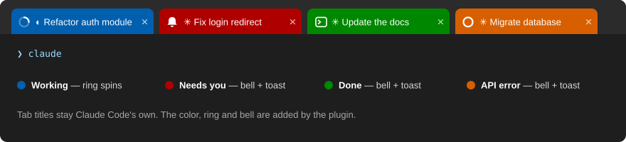
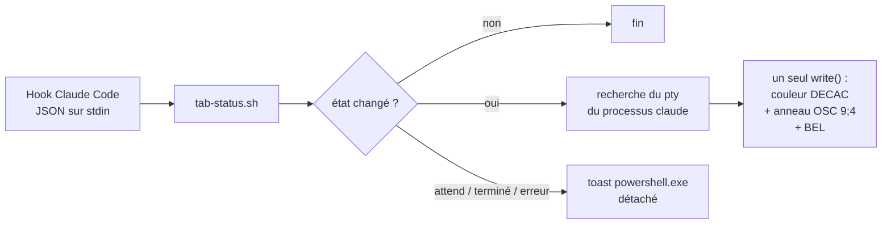

# terminal-addons

[](https://github.com/Yannis-Adn/terminal-addons/actions/workflows/ci.yml)
[](LICENSE)


[English](README.md) · **Français**

Plugins Claude Code pour **Windows Terminal sous WSL**.

## wt-tab-status

**Voir d'un coup d'œil quel onglet Claude Code travaille, lequel vous attend et lequel a terminé.**

C'est l'équivalent, pour Windows Terminal, des onglets de l'intégration Claude Code d'iTerm2. Chaque onglet où tourne Claude Code sous WSL prend la couleur de l'état de Claude et affiche un anneau de progression pendant le travail. Quand Claude vous attend ou a terminé, la cloche sonne et une notification Windows s'affiche.



### Fonctionnalités

- **Couleur d'onglet selon l'état** : bleu pendant le travail, rouge quand Claude vous attend, vert quand il a terminé, orange sur une erreur d'API. L'onglet reprend la couleur du profil à la fin de la session.
- **Anneau de progression** dans l'onglet pendant le travail. L'attente et l'erreur s'affichent aussi sur le bouton de la barre des tâches, en jaune et en rouge.
- **Cloche** quand Claude vous attend ou a terminé : son, indicateur 🔔 sur les onglets en arrière-plan, clignotement de la barre des tâches.
- **Notification Windows (toast)** avec le nom du projet et du contexte : l'outil et la commande à approuver, ou le début de la réponse de Claude. En français ou en anglais.
- **Gère les cas délicats** : sous-agents parallèles ou en arrière-plan, auto-compaction, `/resume`, interruptions par Échap, hooks simultanés, `claude -p` imbriqués.
- **Aucune dépendance** : bash pur et le PowerShell fourni avec Windows. Un hook prend quelques millisecondes et n'écrit rien tant que l'état ne change pas.

### États

| État | Déclenché par | Onglet | Anneau | Cloche + toast |
|---|---|---|---|---|
| Neutre | ouverture et fermeture de session | couleur du profil | — | — |
| En cours | prompt envoyé, appels d'outils | 🟦 bleu | tourne | — |
| Vous attend | demande de permission, `AskUserQuestion`, validation d'un plan, élicitation MCP | 🟥 rouge | plein (barre des tâches jaune) | ✅ |
| Terminé | fin du tour de Claude | 🟩 vert | — | ✅ |
| Erreur API | tour interrompu par une erreur d'API | 🟧 orange | plein (barre des tâches rouge) | ✅ |

Le titre de l'onglet n'est pas modifié : Claude Code continue d'y écrire le sujet de la conversation.

### Prérequis

- Windows 10 ou 11 avec **Windows Terminal 1.15 ou plus** (testé sur 1.24)
- **Claude Code lancé dans WSL 2** (testé avec Claude Code 2.1.28x sous Ubuntu)
- Rien d'autre : ni `jq`, ni Python, ni Node, ni module PowerShell

### Installation

Dans Claude Code :

```
/plugin marketplace add Yannis-Adn/terminal-addons
/plugin install wt-tab-status@terminal-addons
```

Ouvrez ensuite une nouvelle session Claude Code : les hooks se chargent au démarrage d'une session.

### Réglages recommandés

**Cloche : indicateur 🔔 et clignotement de la barre des tâches.** Ajoutez `bellStyle` aux réglages par défaut des profils, dans le `settings.json` de Windows Terminal (`Ctrl+Maj+,`) :

```json
"profiles": {
    "defaults": {
        "bellStyle": ["audible", "taskbar"]
    }
}
```

Mettez `["taskbar"]` pour une cloche silencieuse. Avec `"none"`, l'indicateur de l'onglet disparaît aussi.

**Langue des toasts.** Les toasts suivent la langue d'affichage de Windows : français, ou anglais pour toute autre langue. Pour en imposer une, ajoutez dans `~/.claude/settings.json` :

```json
{ "env": { "WT_TAB_STATUS_LANG": "fr" } }
```

**Libération plus rapide après Échap.** Aucun hook ne se déclenche quand vous interrompez Claude avec Échap. L'onglet est libéré par la notification `idle_prompt` de Claude Code, envoyée par défaut 60 secondes après la fin du tour. Vous pouvez raccourcir ce délai dans `~/.claude.json` (clé non documentée, susceptible de changer) :

```json
"messageIdleNotifThresholdMs": 5000
```

**Ne pas déranger.** Les toasts arrivent quand même dans le centre de notifications (`Win+N`), mais Windows masque leur bannière. Pour les laisser passer : *Paramètres → Système → Notifications → Définir les notifications prioritaires → Ajouter des applications → Terminal*.

### Fonctionnement



- Tous les hooks appellent un seul script, [`tab-status.sh`](plugins/wt-tab-status/scripts/tab-status.sh). Il lit le JSON de l'événement, calcule l'état visé et ne fait rien si l'état n'a pas changé. L'état est gardé dans un petit fichier par session, mis à jour sous `flock`.
- **Pourquoi écrire directement dans le pty ?** Depuis Claude Code 2.1.139, les hooks tournent sans terminal de contrôle : `/dev/tty` n'est pas disponible. La sortie officielle `terminalSequence` n'accepte que OSC 0/1/2/9/99/777 et BEL. Elle refuse donc la séquence DECAC (`CSI 2;fg;bg ,|`) qu'utilise Windows Terminal pour la couleur des onglets. Le script trouve le pty en remontant `/proc` jusqu'au premier processus `claude`. Si ce processus n'a pas de pty (`claude -p`, SDK), rien n'est écrit : un `claude` imbriqué ne colore jamais l'onglet de la session parente.
- La couleur, l'anneau et la cloche partent en **un seul `write()`**, ce qui limite le risque d'entrelacement avec l'affichage de Claude.
- Le toast est construit par [`toast.ps1`](plugins/wt-tab-status/scripts/toast.ps1) via `powershell.exe -EncodedCommand`, détaché avec `setsid -f` : le hook ne l'attend jamais. Le JSON passe par stdin, sans guillemets à échapper ni chemin à convertir.

### Limites

- **Échap** : aucun hook ne signale une interruption. L'onglet reste bleu ou rouge jusqu'à `idle_prompt` (voir *Libération plus rapide après Échap*). Si vous tapez quelque chose entre-temps, Claude n'envoie pas `idle_prompt` et l'onglet se met à jour à votre prompt suivant.
- **Une permission que vous venez d'accorder** laisse l'onglet rouge jusqu'à la fin de l'outil.
- **Demande de permission d'un sous-agent** : l'onglet passe au rouge environ 6 secondes après son affichage. Les sous-agents en arrière-plan déclenchent le hook de permission pour des demandes qu'ils ne peuvent pas afficher : seule la notification qui suit est prise en compte.
- Un shell ou un moniteur en arrière-plan (un serveur de dev, par exemple) ne garde pas l'onglet en bleu. Un sous-agent en arrière-plan, si.
- **tmux** n'est pas pris en charge : le plugin ne fait rien quand `$TMUX` est défini.
- Si Claude Code est tué brutalement, la couleur reste jusqu'à la prochaine session Claude dans cet onglet.
- **Confidentialité** : les toasts affichent la commande à approuver et le début de la réponse de Claude, et Windows les conserve dans le centre de notifications.

### Désinstallation

```
/plugin uninstall wt-tab-status@terminal-addons
```

## Développement

```
git clone https://github.com/Yannis-Adn/terminal-addons.git
cd terminal-addons
bash plugins/wt-tab-status/tests/run.sh   # les tests de toast demandent powershell.exe (WSL)
shellcheck plugins/wt-tab-status/scripts/tab-status.sh plugins/wt-tab-status/tests/run.sh
```

Pour essayer vos modifications, ajoutez votre clone comme marketplace : `/plugin marketplace add /chemin/vers/terminal-addons`. Les plugins installés sont des copies en cache : incrémentez `version` dans `plugin.json`, lancez `/plugin marketplace update terminal-addons`, puis mettez à jour le plugin.

Organisation du dépôt :

```
.claude-plugin/marketplace.json        manifeste de la marketplace
plugins/wt-tab-status/
├── .claude-plugin/plugin.json         manifeste du plugin
├── hooks/hooks.json                   12 événements de hooks → tab-status.sh
├── scripts/tab-status.sh              machine à états, recherche du pty, séquences
├── scripts/toast.ps1                  toast Windows (français / anglais)
└── tests/run.sh                       suite de tests (bash, sans framework)
```

## Licence

[MIT](LICENSE)
