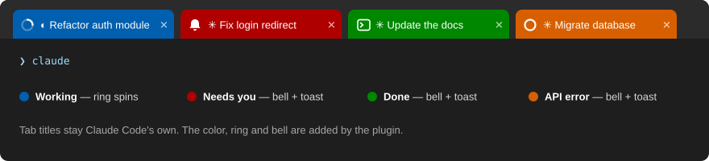
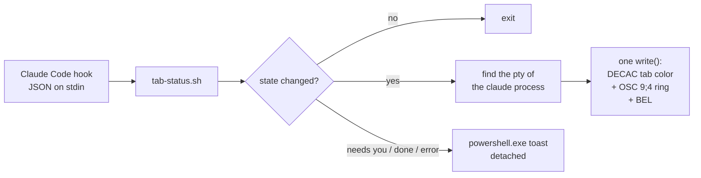

# terminal-addons

[](https://github.com/Yannis-Adn/terminal-addons/actions/workflows/ci.yml)
[](LICENSE)


**English** · [Français](README.fr.md)

Claude Code plugins for **Windows Terminal on WSL**.

## wt-tab-status

**Know at a glance which Claude Code tab is working, which one needs you, and which one is done.**

It brings the tab status of iTerm2's Claude Code integration to Windows Terminal: every tab running Claude Code under WSL changes color with Claude's state, shows a progress ring while Claude works, and rings the bell (and sends a Windows notification) when Claude needs you or has finished.



### Features

- **Tab color by state.** Blue while working, red when Claude needs you, green when done, orange on an API error. Back to the profile color when the session ends.
- **Progress ring** in the tab while Claude works. Waiting and error states also show on the taskbar button (yellow and red).
- **Bell** when Claude needs you or is done: sound, 🔔 indicator on background tabs, taskbar flash.
- **Windows toast** with the project name and some context: the tool and command waiting for approval, or the start of Claude's answer. In English or French.
- **Handles the tricky cases.** Parallel and background subagents, auto-compaction, `/resume`, Esc interrupts, concurrent hooks, nested `claude -p` runs.
- **No dependencies.** Pure bash and the Windows PowerShell that ships with Windows. A hook takes a few milliseconds and only writes when the state changes.

### States

| State | Triggered by | Tab | Ring | Bell + toast |
|---|---|---|---|---|
| Neutral | session start and end | profile color | — | — |
| Working | prompt sent, tool calls | 🟦 blue | spinning | — |
| Needs you | permission prompt, `AskUserQuestion`, plan approval, MCP elicitation | 🟥 red | full (yellow taskbar) | ✅ |
| Done | end of Claude's turn | 🟩 green | — | ✅ |
| API error | turn ended by an API error | 🟧 orange | full (red taskbar) | ✅ |

The tab title is untouched: Claude Code keeps writing its own title (the conversation topic).

### Requirements

- Windows 10 or 11 with **Windows Terminal 1.15+** (tested on 1.24)
- **Claude Code running inside WSL 2** (tested with Claude Code 2.1.28x on Ubuntu)
- Nothing else: no `jq`, no Python, no Node, no PowerShell module

### Install

In Claude Code:

```
/plugin marketplace add Yannis-Adn/terminal-addons
/plugin install wt-tab-status@terminal-addons
```

Then start a new Claude Code session: hooks are loaded at session start.

### Recommended settings

**Bell: 🔔 indicator and taskbar flash.** Add `bellStyle` to the profile defaults in Windows Terminal's `settings.json` (`Ctrl+Shift+,`):

```json
"profiles": {
    "defaults": {
        "bellStyle": ["audible", "taskbar"]
    }
}
```

Use `["taskbar"]` for a silent bell. With `"none"`, the tab indicator is hidden too.

**Toast language.** Toasts follow the Windows display language (French, or English for any other language). To force one, set it in `~/.claude/settings.json`:

```json
{ "env": { "WT_TAB_STATUS_LANG": "en" } }
```

**Faster reset after Esc.** No hook fires when you interrupt Claude with Esc. The tab is released by Claude Code's `idle_prompt` notification, 60 seconds after the turn by default. You can shorten that delay in `~/.claude.json` (undocumented key, may change):

```json
"messageIdleNotifThresholdMs": 5000
```

**Do Not Disturb.** Toasts still reach the notification center (`Win+N`), but Windows hides their banner. To let them through: *Settings → System → Notifications → Set priority notifications → Add apps → Terminal*.

### How it works



- Every hook calls one script, [`tab-status.sh`](plugins/wt-tab-status/scripts/tab-status.sh). It reads the event JSON, computes the target state, and does nothing when the state is unchanged (one small state file per session, updated under `flock`).
- **Why write to the pty directly?** Since Claude Code 2.1.139, hooks run without a controlling terminal, so `/dev/tty` is not available. The official `terminalSequence` output only accepts OSC 0/1/2/9/99/777 and BEL, not the DECAC sequence (`CSI 2;fg;bg ,|`) Windows Terminal uses for tab colors. The script finds the pty by walking up `/proc` to the first `claude` process. If that process has no pty (`claude -p`, SDK), nothing is written, so a nested run never colors its parent's tab.
- The color, the ring and the bell go out in a **single `write()`**, which limits the risk of interleaving with Claude's own rendering.
- The toast is built by [`toast.ps1`](plugins/wt-tab-status/scripts/toast.ps1) through `powershell.exe -EncodedCommand`, detached with `setsid -f`, so the hook never waits for it. The JSON goes through stdin, so no quoting or path translation is involved.

### Limitations

- **Esc interrupts** are not reported by any hook: the tab stays blue or red until `idle_prompt` (see *Faster reset after Esc*). If you type something in the meantime, Claude skips `idle_prompt` and the tab updates on your next prompt.
- **A permission you just approved** keeps the tab red until the tool finishes.
- **Subagent permission prompts** turn the tab red about 6 seconds after they appear. Background subagents trigger the permission hook for requests they cannot show, so only the notification that follows is trusted.
- A background shell or monitor (a dev server, for example) does not keep the tab blue. A background subagent does.
- **tmux** is not supported. The plugin does nothing when `$TMUX` is set.
- If Claude Code is killed abruptly, the color stays until the next Claude session in that tab.
- **Privacy:** toasts show the command awaiting approval and the start of Claude's answer, and Windows keeps them in the notification center.

### Uninstall

```
/plugin uninstall wt-tab-status@terminal-addons
```

## Development

```
git clone https://github.com/Yannis-Adn/terminal-addons.git
cd terminal-addons
bash plugins/wt-tab-status/tests/run.sh   # toast tests need powershell.exe (WSL)
shellcheck plugins/wt-tab-status/scripts/tab-status.sh plugins/wt-tab-status/tests/run.sh
```

To try local changes, add your clone as a marketplace: `/plugin marketplace add /path/to/terminal-addons`. Installed plugins are cached copies, so bump `version` in `plugin.json` and run `/plugin marketplace update terminal-addons`, then update the plugin.

Repository layout:

```
.claude-plugin/marketplace.json        marketplace manifest
plugins/wt-tab-status/
├── .claude-plugin/plugin.json         plugin manifest
├── hooks/hooks.json                   12 hook events → tab-status.sh
├── scripts/tab-status.sh              state machine, pty lookup, escape sequences
├── scripts/toast.ps1                  Windows toast (English / French)
└── tests/run.sh                       test suite (bash, no framework)
```

## License

[MIT](LICENSE)
